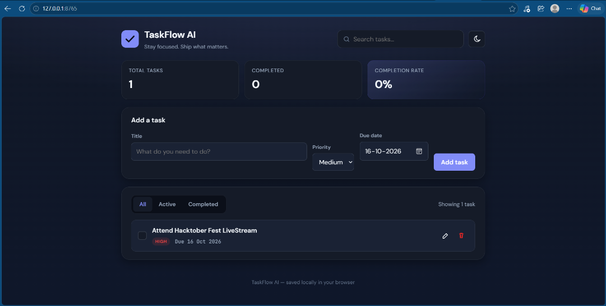

<div align="center">

# ✅ TaskFlow AI

### _Stay focused. Ship what matters._

A polished, zero-dependency browser-based task manager built with pure HTML, CSS, and Vanilla JavaScript.

[](https://tuhinjalui.github.io/TaskFlow-AI/)
[](LICENSE)
[](https://developer.mozilla.org/en-US/docs/Web/HTML)
[](https://developer.mozilla.org/en-US/docs/Web/CSS)
[](https://developer.mozilla.org/en-US/docs/Web/JavaScript)

</div>

---

## 📸 Preview

<p align="center">
  
</p>

> TaskFlow AI features a modern, minimal UI with light & dark mode, live stats, and smart filtering — all running entirely in your browser with zero setup.

---

## ✨ Features

| Feature | Description |
|---|---|
| 📝 **Add Tasks** | Create tasks with a title, priority level (High / Medium / Low), and due date |
| ✏️ **Edit Tasks** | Update any task via a smooth modal dialog |
| ✅ **Complete / Undo** | Toggle tasks between active and completed states |
| 🗑️ **Delete Tasks** | Remove tasks instantly from the list |
| 📊 **Live Statistics** | Real-time dashboard showing total, completed, and completion rate |
| 🔍 **Search** | Filter tasks by title with instant live search |
| 🏷️ **Filter Tabs** | View All, Active, or Completed tasks at a glance |
| ⚠️ **Overdue Detection** | Overdue tasks are highlighted automatically |
| 🌙 **Dark / Light Mode** | Seamless theme toggle with system preference detection |
| 💾 **Local Persistence** | Tasks and theme preference saved via `localStorage` |
| 📱 **Fully Responsive** | Works beautifully on mobile, tablet, and desktop |
| ♿ **Accessible** | Semantic HTML, ARIA attributes, keyboard navigation, and focus management |

---

## 🛠️ Tech Stack

- **Structure** — HTML5 (semantic, accessible markup)
- **Styling** — Vanilla CSS3 (CSS custom properties, Grid, Flexbox, animations)
- **Logic** — Vanilla JavaScript (ES5-compatible IIFE, no frameworks, no build tools)
- **Storage** — Browser `localStorage` API
- **Typography** — [DM Sans](https://fonts.google.com/specimen/DM+Sans) + [JetBrains Mono](https://fonts.google.com/specimen/JetBrains+Mono) via Google Fonts

> **Zero dependencies.** No `npm install`. No bundler. No framework. Just open and go.

---

## 📁 Project Structure

```
TaskFlow-AI/
├── assets/
│   └── preview.png # App screenshot / preview
├── index.html      # App shell — markup, semantic structure, dialog, header
├── style.css       # Design system — CSS tokens, layout, animations, dark mode
├── script.js       # App logic — state management, CRUD, rendering, events
└── README.md       # Project documentation
```

---

## 🚀 Getting Started

This is a purely static frontend project — **no build step required**.

### Option 1 — Open Directly

Simply double-click `index.html` or drag it into your browser.

### Option 2 — Local Dev Server (Recommended)

Using a local server avoids potential browser restrictions with the `file://` protocol.

**With Python:**
```bash
python -m http.server 4173
```

**With Node.js (npx):**
```bash
npx serve .
```

Then visit: **http://localhost:4173**

---

## 🏗️ Architecture Overview

The app is structured as a self-contained IIFE (Immediately Invoked Function Expression) with a clear separation of concerns:

```
┌─────────────────────────────────────────────┐
│                  script.js                  │
│                                             │
│  ┌──────────┐   ┌──────────┐  ┌─────────┐  │
│  │  State   │──▶│  Logic   │─▶│  DOM    │  │
│  │ (tasks,  │   │ (CRUD,   │  │ Render  │  │
│  │ filter,  │   │ validate,│  │ (Task   │  │
│  │ search)  │   │ theme)   │  │  List,  │  │
│  └──────────┘   └──────────┘  │  Stats, │  │
│       │                       │  Dialog)│  │
│       ▼                       └─────────┘  │
│  ┌──────────┐                              │
│  │  Local   │                              │
│  │ Storage  │                              │
│  └──────────┘                              │
└─────────────────────────────────────────────┘
```

### Key Modules

| Function | Role |
|---|---|
| `init()` | Bootstraps the app, caches DOM refs, loads data |
| `renderTasks()` | Diffs and re-renders the visible task list |
| `addTask()` | Creates and prepends a new task to state |
| `toggleComplete()` | Flips a task's completed status |
| `deleteTask()` | Removes a task by ID from state |
| `openEditDialog()` | Populates and shows the edit modal |
| `saveEdit()` | Validates and commits edits to state |
| `setFilter()` | Updates active filter and re-renders |
| `updateStats()` | Recomputes and writes dashboard counters |
| `applyTheme()` | Writes `data-theme` attribute to `<html>` |
| `loadTasks()` / `saveTasks()` | Reads/writes tasks via localStorage |

---

## 🎨 Design System

The entire design is token-driven via CSS custom properties:

```css
/* Colors, spacing, shadows, and radii — all in one place */
:root {
  --primary: #4f46e5;          /* Indigo accent */
  --priority-high: #ef4444;    /* Red for high priority */
  --priority-medium: #f59e0b;  /* Amber for medium priority */
  --priority-low: #10b981;     /* Green for low priority */
  --overdue: #dc2626;          /* Red for overdue dates */
  --radius-xl: 20px;           /* Card corners */
}
```

Dark mode variables override the root tokens under `[data-theme="dark"]` — no JavaScript required for theme transitions.

---

## ♿ Accessibility

TaskFlow AI is built with accessibility as a first-class concern:

- ✅ Semantic HTML5 landmarks (`<header>`, `<main>`, `<footer>`, `<dialog>`)
- ✅ ARIA roles, labels, and `aria-live` regions for dynamic content
- ✅ Full keyboard navigation and focus trapping in modal
- ✅ `focus-visible` ring on all interactive elements
- ✅ `Escape` key closes the edit dialog
- ✅ Focus restored to the triggering element after dialog close
- ✅ Visually hidden labels for screen readers

---

## 🧪 Manual Test Checklist

Before demoing or deploying, run through these checks:

- [ ] Add a task with a valid title, priority, and due date
- [ ] Confirm new task appears in the list immediately
- [ ] Confirm statistics update after adding tasks
- [ ] Mark a task complete and verify counts and percentage update
- [ ] Uncheck a completed task and verify stats revert
- [ ] Edit a task — confirm title, priority, and date changes persist
- [ ] Cancel edit dialog — confirm no changes were applied
- [ ] Close dialog with the ✕ button and with the `Escape` key
- [ ] Delete a task — confirm it disappears from the list
- [ ] Filter by `All`, `Active`, and `Completed`
- [ ] Search for an existing task — only matching items should appear
- [ ] Search for a non-existent term — empty state should appear
- [ ] Refresh the page — tasks should still be there
- [ ] Toggle theme — refresh and confirm preference persists
- [ ] Resize to mobile width — layout should remain fully usable

---

## 🔮 Possible Future Enhancements

- [ ] Bulk actions (select all, delete completed)
- [ ] Drag-and-drop task reordering
- [ ] Category / tag support
- [ ] Task notes / description field
- [ ] Cloud sync or backend integration (e.g., Firebase, Supabase)
- [ ] Export tasks to CSV or JSON
- [ ] PWA support (offline-first, installable)
- [ ] Keyboard shortcut cheatsheet

---

## 📄 License

This project is open-source under the [MIT License](LICENSE).

---

<div align="center">

Made with ❤️ by **Tuhin Jalui**

_If you found this useful, please give it a ⭐ on GitHub!_

</div>
